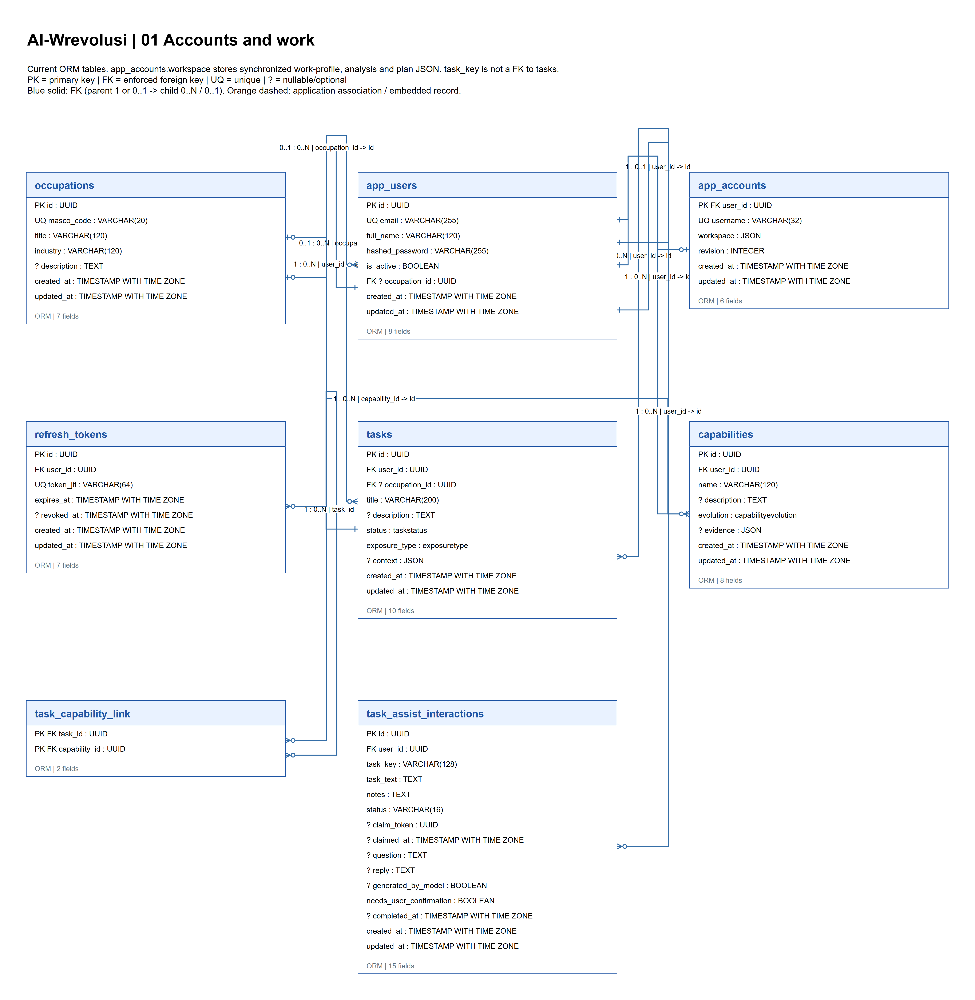
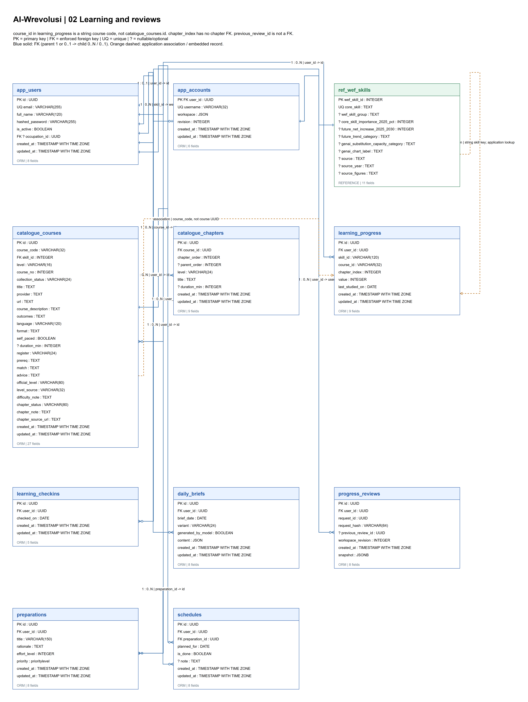
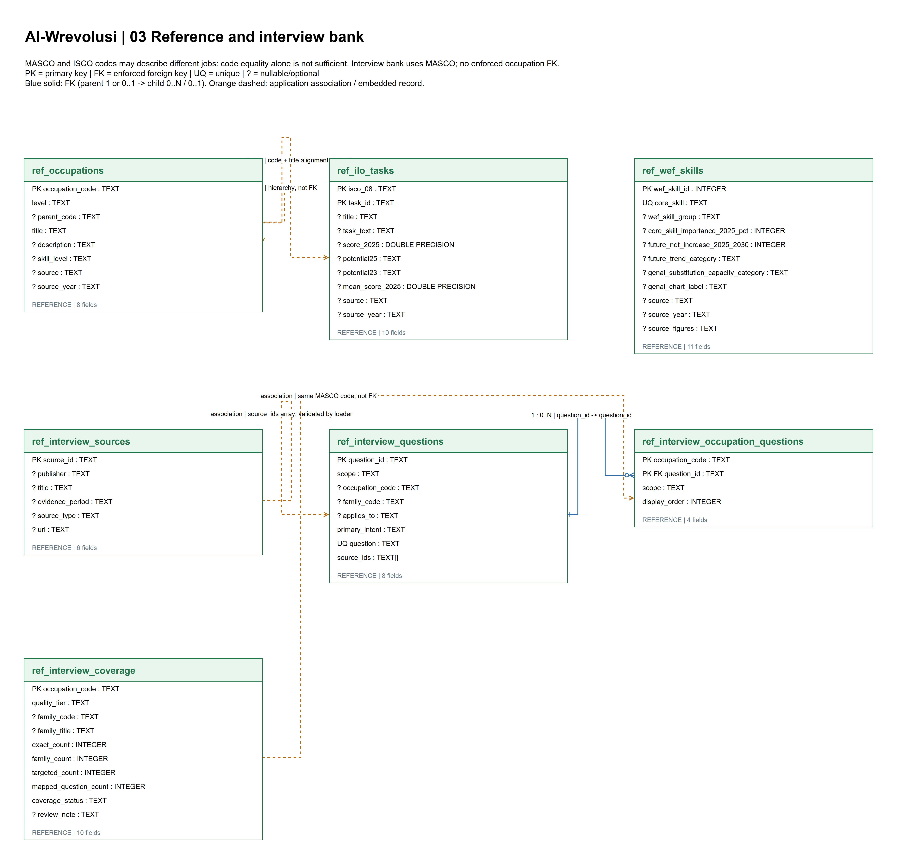
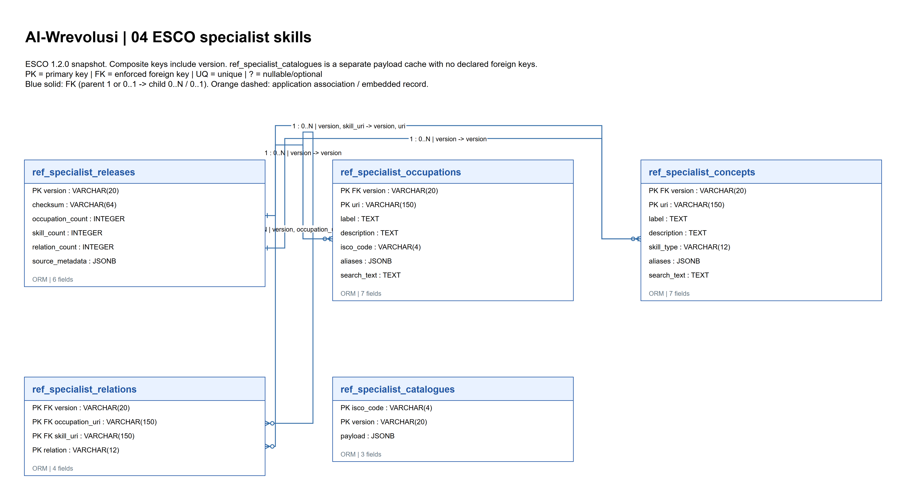
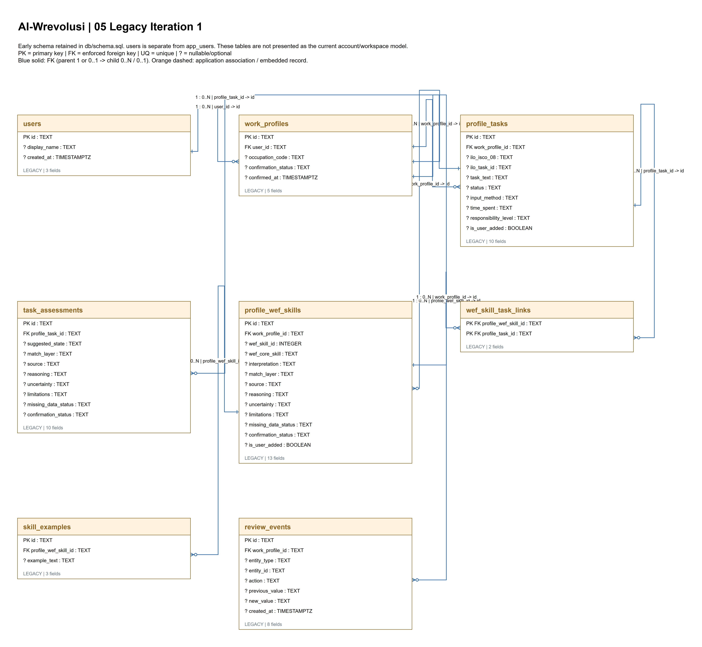
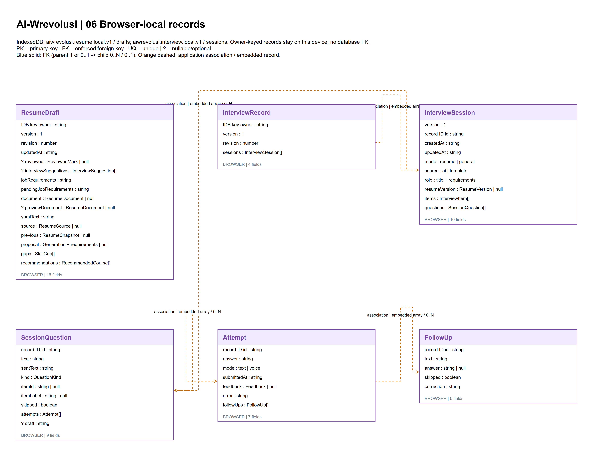
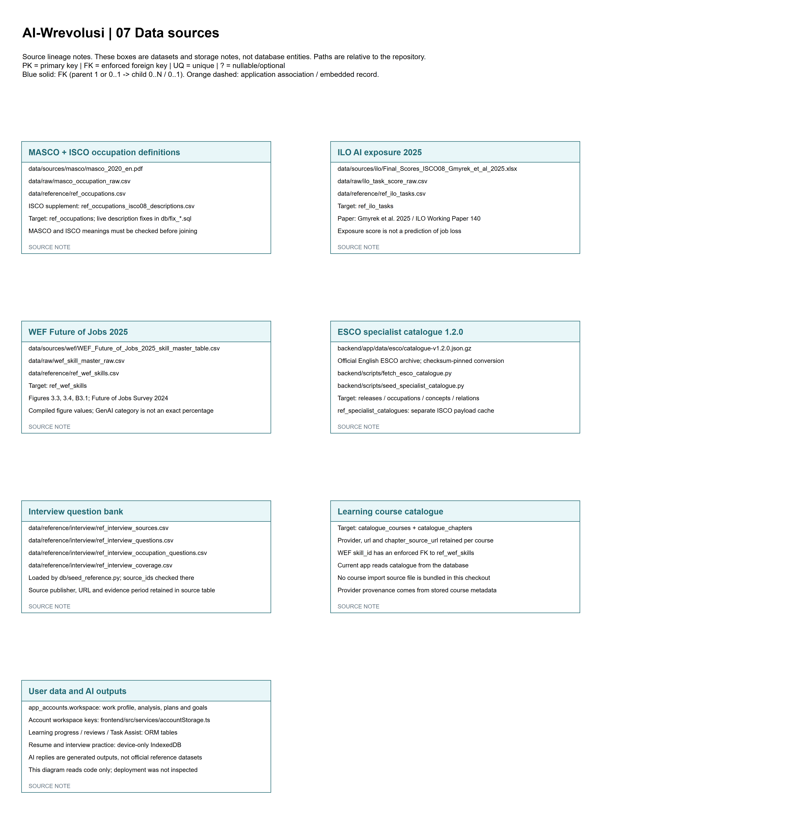

# Data Management Plan and ERD — Iteration Build

**Project:** AI-Wrevolusi  
**Course:** FIT5120 Industry Experience Studio Project  
**Evidence snapshot:** 12 October 2026  
**Source tree:** `main` at `ed5bd48`, with uncommitted working-tree changes present  
**Status:** Iteration 3 implementation report; source review only

## Executive summary

AI-Wrevolusi currently uses a hybrid data architecture. PostgreSQL stores account records, application activity, learning records and reference data. A signed-in user's broader work profile, analysis and learning-plan selections are synchronized as an allow-listed JSON workspace document. Resume drafts and interview-practice sessions are separate, account-keyed IndexedDB records on the user's browser; they are not part of the server workspace sync.

The supplied ERD contains seven pages covering current relational structures, reference data, legacy Iteration 1 tables, browser-local records and data-source lineage. It correctly distinguishes database-enforced foreign keys from application-level associations and embedded JSON. The seven ERD pages are embedded in Section 8 as rendered figures, and the original editable `.drawio` companion is preserved. No diagram entities or relationships have been redrawn.

Three material gaps must remain explicit in the PGP: the six-month retention/deletion policy is documented but no automated purge or account-wide deletion workflow was found; no project-controlled backup schedule, restore runbook or restore-test evidence was found; and the checked-in migration chain is not a reproducible bootstrap for a clean database. These are implementation gaps, not claims about provider capabilities. No live database, hosted environment, backup configuration or restore was inspected.

## 1. Scope, evidence and limits

This plan describes data visible in the current repository and the supplied ERD. It covers the data lifecycle, storage locations, access boundaries, source-data provenance, privacy, retention, deletion, backup/recovery and Iteration 3 build status. The code review did not connect to Neon, Vercel or an AI provider and did not inspect production rows, secrets or hosted settings.

The repository is on `main` at `ed5bd48`, and the working tree contains substantial uncommitted changes, including a Resume Builder learning-skills flow and focused backend/frontend tests. Findings therefore describe the local source snapshot, not solely the committed revision and not necessarily the deployed application. The team chat on 12 October reported that the deployed Resume Builder was working after earlier issues, including a report that newly selected skills were not being added to the resume. The local tests and deployment behavior were not independently run or verified for this report.

The document does not claim legal or regulatory compliance. The team should confirm the user notice, consent language, provider terms, data-retention scope and operational ownership before treating the proposed controls as policy.

## 2. Current data architecture

### 2.1 Storage layers

1. **Source and reference-data layer.** Public occupational, task, skills, interview-question and course information is represented in project source files and reference tables. CSV sources are reviewed and loaded by seed scripts. The codebase documents lineage for MASCO, ILO AI-exposure data, WEF skills, ESCO and the interview-question bank. Learning-course records are read from the database; the checked-in project does not contain a complete course-catalogue import source file.
2. **Server database.** The backend is configured for PostgreSQL through SQLAlchemy and `asyncpg`; deployment documentation describes separate Neon Preview and Production branches. The actual connected provider, branch, schema and data are not verified. Current application tables store account/authentication records, tasks and capabilities, learning activity, schedules and progress-review snapshots. Some reference tables are created/seeded by SQL scripts rather than represented as ordinary account-owned ORM records.
3. **Account workspace.** `app_accounts.workspace` stores allow-listed, serialized work-profile, analysis, planning and related selections in JSON. The API validates allowed keys and payload size, checks account ownership, locks the row during updates and rejects stale revisions. The browser also keeps a local workspace cache; signed-in writes are synchronized to the server.
4. **Browser-local resume and interview data.** Resume drafts and interview sessions are in separate IndexedDB databases, keyed by account ID. They are not uploaded as part of account-workspace synchronization and persist after logout. Account namespacing is not device encryption; browser eviction, private-browsing expiry or clearing site data can lose these records.
5. **External AI/rendering services.** Selected, reviewed and redacted evidence can be sent to the configured resume-generation provider. The complete structured resume document is sent separately to the PDF rendering endpoint, including personal fields. Original PDF/DOCX uploads are parsed locally; the originals are not uploaded by the described workflow. Third-party retention policies apply, and the UI does not promise zero supplier retention.

### 2.2 Data inventory

| Data class | Examples | Current storage and processing | Classification / control boundary |
|---|---|---|---|
| Account identity and authentication | Internal user ID, username, email field, full name, password hash, active status, refresh-token records | PostgreSQL `app_users`, `app_accounts` and `refresh_tokens`; authentication cookies are configured as HttpOnly with environment-controlled security settings | Personal / credential-related. Passwords are hashed; account APIs require authentication. Never place production secrets in Git or reports. |
| Work profile and career analysis | Occupation, task descriptions, capability evidence, analysis results, career direction and selected possibilities | Allow-listed keys in `app_accounts.workspace` JSON, with selected task/capability data also represented relationally | Personal and potentially sensitive career information. Workspace data is account-owned and revision-checked. |
| Learning and progress activity | Learning goals/plans, course selections, progress, check-ins, daily briefs, preparation schedules and progress reviews | Workspace JSON plus user-linked PostgreSQL tables; progress-review snapshots use JSONB | Personal behavioral/progress data. User-linked foreign keys exist for many records; no self-service account-wide deletion flow was found. |
| Resume drafts and interview practice | Resume document, requirements, reviewed source evidence, interview questions, answers and feedback | Account-keyed browser IndexedDB; local resume export/clear and individual interview-session deletion are exposed | Personal data. Local-only and not centrally backed up; IndexedDB account namespacing does not encrypt data on the device. |
| Reference datasets | MASCO/ISCO occupations, ILO task exposure, WEF skills, ESCO specialist catalogue, interview sources/questions and course records | Versioned project source files and PostgreSQL reference/catalogue tables, loaded or updated by seed scripts | Public/reference data. Preserve source, year, URL/checksum and transformation lineage where available; do not present exposure scores as predictions of job loss. |
| AI-generated or derived content | Suggested task/skill matches, summaries, learning guidance, resume proposals and course recommendations | Some results are transient; selected workspace/progress data may be persisted. Resume AI and rendering use distinct endpoints | Derived content is not authoritative evidence. Validate model output against supplied candidates and facts; disclose external processing and require user review. |
| Operational configuration | Database URL, JWT secret and AI provider credentials/settings | Environment configuration outside source-controlled application data | Secret. Keep in deployment secret stores or local ignored environment files; do not copy values into this plan, logs or Git. |

## 3. Data lifecycle and governance

### 3.1 Collection and validation

Users enter account, occupation, task, learning and career-planning information through authenticated application flows. Workspace payloads are limited to an explicit set of supported keys, JSON-decoded and validated for selected data types. A 2 MB serialized payload limit is enforced. Owner-ID and revision checks prevent a stale or different account session from silently overwriting newer workspace data.

Reference data follows a separate pipeline: source files are transformed into raw/reference CSV layers, reviewed and loaded into database tables by seed scripts. Interview-bank source IDs are checked by the loader. A seed operation with `--replace` rebuilds reference rows; it is not a user-data backup and must not be described as one. Before running it against any shared environment, confirm the target database and the operation's scope.

### 3.2 Use and disclosure

Application data supports work-profile analysis, task/capability matching, learning-plan and progress features, resume assistance and interview practice. AI outputs must be treated as suggestions. In the resume workflow, users review/redact evidence and confirm source skills before AI generation; the provider response is constrained against supplied facts/skill IDs. The PDF-render endpoint receives the complete structured document separately. The UI states that provider retention policies apply.

**Plan control:** keep only the information needed for a feature, disclose exactly which content is sent to each third party, and avoid logging prompts, resume content or credentials. Confirm that configured production providers, privacy notices and retention terms match the code-level disclosure before release.

### 3.3 Access and integrity

- Authentication uses a password-hashing library and token-based sessions. Cookies are HttpOnly; the `Secure`, `SameSite` and domain settings depend on runtime configuration and were not inspected in a hosted environment.
- Workspace API access is tied to the authenticated account. Updates check the owner and revision and use a row lock to prevent silent concurrent overwrites.
- Many relational user records reference the account/user with cascade constraints. A cascade is a database integrity rule; it is not a user-facing deletion service.
- Browser-local resume/interview records are keyed by account ID but remain readable within the same browser profile. Account namespacing is not equivalent to device encryption.
- Reference data and application/user data are separate logical categories. Reference-table replacement must not be used as a substitute for account-data backup or deletion.

## 4. Retention, export and deletion

The Iteration 1 data dictionary documents a team policy to retain accounts and user-generated data for six months after last active use, with deletion available on request. Repository review found no scheduled six-month purge and no account-wide deletion route. The account APIs inspected provide registration, login, identity and workspace read/write; user APIs provide read/update. Thus the six-month rule is a documented policy, not a verified automated control.

Some local controls exist: a user can export a resume draft as YAML, clear that account's local resume draft and delete individual interview sessions. These actions do not delete server-side account/workspace or relational learning records. A limited workspace-sync recovery alert can download an unsynced local workspace cache; it is not a complete account export and does not include server-only relational data or IndexedDB records. The logout flow revokes session credentials and clears workspace browser state after its pending workspace-save step succeeds; if that save fails, cleanup does not proceed. Logout is not account deletion, and IndexedDB resume/interview records survive logout.

**Required decision and implementation:** define the retention clock and scope for account records, server workspace, relational activity, browser-local records, logs, backups and third-party processing. Implement and test a user-requested account-wide export/deletion flow, cascade validation, scheduled expiry policy and clear user-facing instructions for local IndexedDB. Retention requirements for backups/provider copies must be stated separately; deletion from the active database does not automatically erase historical backups.

## 5. Backup and recovery plan

### 5.1 Current verified state

No repository-controlled database-backup schedule, backup artifact workflow, restore command/runbook or restore-test evidence was found. Neon/provider-level backup or point-in-time recovery settings were not inspected, so provider capability and configuration remain **not verified**. The browser-local resume and interview stores have no central backup; the resume YAML export and the unsynced-workspace recovery download are limited user recovery aids, not a full backup. The team chat on 12 October explicitly raised missing “backup storage”; whether that work was subsequently completed is unknown.

### 5.2 Proposed control (not yet implemented/verified)

1. Assign an owner and choose the approved backup storage/service for PostgreSQL backups. Record its region, access policy, encryption, retention, credentials owner and whether it is separate from the application database account.
2. Agree the recovery point objective (RPO), recovery time objective (RTO), backup frequency and retention with the team before describing them as commitments. Enable the selected provider's scheduled backup/PITR controls only after checking Preview versus Production scope.
3. Back up before destructive seed replacement and database migrations. Keep schema/migration and reference-source provenance alongside, but separate from, sensitive user-data backup artifacts. Never commit database dumps, user records or credentials to the code repository.
4. Write a restore runbook for a disposable or isolated database branch. Test restoring both schema and representative data, validating row counts, foreign keys, account/workspace access and application startup. Record the test date, owner, outcome and limitations.
5. Document the browser-local boundary clearly. If the product requires device-loss recovery, implement a consented, encrypted server-side backup/export path for resume/interview records; do not imply the present local stores are covered by Neon backups.
6. Treat application-code rollback and database recovery as separate operations. Deployment guidance warns that reverting application code does not reverse database changes.

**ERD/architecture treatment:** backup storage is an infrastructure/data-flow component, not automatically a relational entity. Show the selected backup destination, data scope and restore path in the architecture/data-flow view. Add a database entity only if the application itself needs to track backup metadata. Until the team chooses and verifies a destination, mark this component “planned / not verified,” not as an implemented store.

## 6. Data quality, provenance and schema management

The source-data documentation defines public-source → raw → reference layers and records provenance for MASCO, ILO, WEF, ESCO and interview questions. The ILO exposure score is explicitly not a job-loss prediction. ESCO conversion is version/checksum pinned. Some relationships are validated by application loaders rather than foreign keys; the ERD labels these as application associations. Course records preserve provider/URL metadata, but a complete course import source is not bundled in the checked-out repository.

The database setup needs a controlled baseline before production changes. The checked-in Alembic chain reaches `0007_progress_reviews`; however, its first revision expects `app_users` without creating it, and another revision expects SQL-seeded `ref_wef_skills`. `backend/scripts/setup_accounts.py` separately creates account/auth tables outside that chain. The older `db/schema.sql` contains Iteration 1 `users`/`work_profiles` structures and is not the current `app_users` schema. The database-baseline proposal is also stale in describing an earlier migration revision. Therefore, do not claim the repository can create or upgrade a clean production database reproducibly without an environment-specific baseline/adoption plan and a successful disposable-database rehearsal.

## 7. Iteration Build — current implementation evidence

| Build area | Current source evidence | Status and boundary |
|---|---|---|
| Account and workspace sync | FastAPI account APIs, `app_users`/`app_accounts`, allow-listed JSON workspace, ownership and revision checks | Implemented in source. Hosted configuration and production behavior not independently verified. |
| Work, tasks and capabilities | User-linked task/capability records and task-capability association; work/analysis keys are also carried in the workspace | Implemented in source. The ERD distinguishes enforced FKs from keys embedded in JSON or associated in application code. |
| Learning and planning | Learning progress, check-ins, daily briefs, preparations, schedules and catalogue entities; some plan selections remain in workspace JSON | Implemented in source. Do not imply every key in workspace JSON is a normalized table. |
| Progress review | `progress_reviews` table stores request metadata, workspace revision and a JSONB snapshot, with account ownership and a uniqueness constraint for a request | Implemented in source/migration `0007`. Live schema/migration state not checked. |
| Resume Builder and interview practice | Separate IndexedDB stores keyed by account; local resume export/clear and per-session interview deletion are available; the current uncommitted tree adds course-skill extraction/review into resume generation | Implemented in the local working tree as browser-local draft data, not synchronized to the server workspace. Focused backend/frontend tests exist but were not run for this report; deployed behavior is not verified. |
| Reference/catalogue pipeline | Versioned source data and seed tooling for selected occupational, skills and interview reference tables | Partly source-controlled. Actual seeded database contents and deployed versions not checked. |
| Backup storage and restore | No repository runbook or verified backup artifact; raised in team discussion on 12 October | Open gap. Do not mark complete until a destination is selected and a restore test is evidenced. |
| Iteration 3 deployment | Team chat reported the deployment was working; source repository contains current uncommitted changes | Reported by team, not independently tested. The current local tree contains a learning-skills change and focused tests, but neither the tests nor deployed behavior were verified for this report. |

Epic IDs and acceptance status are intentionally not assigned to individual rows here. Team records show an Iteration 3 Epic 8/9 direction, but the technical code-to-story mapping and latest acceptance results were not independently confirmed for this report.

## 8. ERD integration and reading guide

The companion file `AI-Wrevolusi-Iteration-3-ERD.drawio` preserves the supplied diagram source. It has seven pages:

1. **Accounts and work** — current account/work and task/capability records; calls out JSON workspace content and non-FK task keys.
2. **Learning and reviews** — catalogue, learning activity, schedules and progress reviews; distinguishes course/skill codes from database foreign keys.
3. **Reference and interview bank** — MASCO/ISCO, ILO/WEF and interview-question sources/coverage; labels code/title alignments and source arrays as application-level associations where appropriate.
4. **ESCO specialist skills** — versioned release, occupation, concept and relation tables plus the separate payload cache.
5. **Legacy Iteration 1** — historical `users`/`work_profiles`-era tables; not the current account/workspace schema.
6. **Browser-local records** — resume and interview IndexedDB record shapes; they are device-local rather than PostgreSQL entities.
7. **Data sources** — source lineage notes; these boxes are dataset/source notes, not database entities.

In the diagram, solid blue connectors represent enforced database foreign keys; dashed orange connectors represent application associations or embedded records. Use that distinction when discussing data integrity. Do not treat every dashed relationship as a database constraint. The chart’s explicit note that deployment was not inspected remains applicable.

The following figures are rendered directly from the supplied editable ERD source; the entities and relationships have not been redrawn.

### ERD page 1 — Accounts and work

### ERD page 2 — Learning and reviews

### ERD page 3 — Reference and interview bank

### ERD page 4 — ESCO specialist skills

### ERD page 5 — Legacy Iteration 1

### ERD page 6 — Browser-local records

### ERD page 7 — Data sources

<!-- pagebreak -->

## 9. Open actions before PGP sign-off

| Priority | Action | Evidence required to close |
|---|---|---|
| P0 | Select and document backup storage, backup scope, owner, RPO/RTO and retention; add the storage/recovery path to the architecture/data-flow view | Approved destination/settings plus a successful restore rehearsal on an isolated database; record date and result |
| P0 | Resolve database baseline/migration reproducibility before any shared/production migration | Clean disposable database created and upgraded through the documented, reviewed path; verify SQL-owned reference dependencies |
| P1 | Align six-month retention policy with actual server, browser, logs, backup and provider behavior | Approved policy plus tested scheduled deletion and user-requested export/deletion, including local-data instructions |
| P1 | Confirm resume AI and PDF-render provider disclosure and retention terms | Reviewed privacy wording/provider settings; demonstrate only reviewed/redacted evidence goes to AI and identify complete document transfer to renderer |
| P1 | Verify the new resume learning-skills flow in the deployed Iteration 3 build | Focused backend/frontend tests are present in the local uncommitted tree; run them, then verify the deployed build with a selected learning skill and record the environment/result |
| P2 | Reconcile the current ERD and PGP epic/story labels after team review | One canonical approved Epic/story list and consistent identifiers across build, ERD and portfolio documents |

## 10. Evidence register

- **[E1]** `backend/app/models/user.py`, `backend/app/models/account.py`, `backend/app/models/refresh_token.py`; `backend/app/core/security.py`; `backend/app/routers/accounts.py` — account, password hashing, token and workspace behavior.
- **[E2]** `backend/app/models/task.py`, `capability.py`, `learning.py`, `preparation.py`, `schedule.py`, `progress_review.py`; `backend/alembic/versions/0007_progress_reviews.py` — application activity and review snapshots.
- **[E3]** `frontend/src/services/accountStorage.ts`, `frontend/src/components/account/AccountProvider.tsx` — workspace cache/synchronization and unsynced-cache recovery.
- **[E4]** `frontend/src/infrastructure/storage/resumeStore.ts`, `frontend/src/infrastructure/storage/interviewStore.ts`, `frontend/src/pages/ResumeBuilder/ResumeBuilder.tsx`, `frontend/src/pages/InterviewPractice/StartPanel.tsx`, `docs/resume-builder.md` — browser-local resume/interview storage and feature privacy boundary.
- **[E5]** `docs/iteration1_data_management.md`, `docs/iteration1_data_dictionary.md`, `db/seed_reference.py`, `db/schema.sql` — reference-data pipeline, documented six-month policy and older schema.
- **[E6]** `backend/alembic/versions/0001_add_learning_tables.py` through `0007_progress_reviews.py`, `backend/scripts/setup_accounts.py`, `docs/database-baseline-proposal.md` — migration and bootstrap caveats.
- **[E7]** `docs/deployment.md`, `backend/app/core/config.py`, `backend/app/db/session.py` — documented deployment architecture and runtime configuration; not evidence of current hosted settings.
- **[E8]** User-supplied ERD XML attached on 12 October 2026; preserved as the companion `.drawio` file.
- **[E9]** User-supplied team chat export dated 12 October 2026; used only for reported team progress, not as code/deployment verification.
